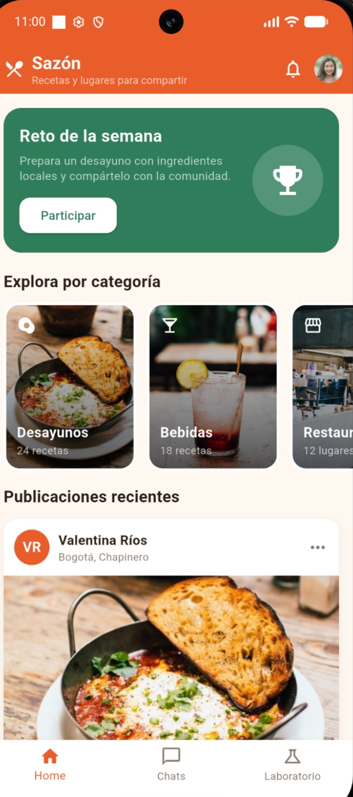
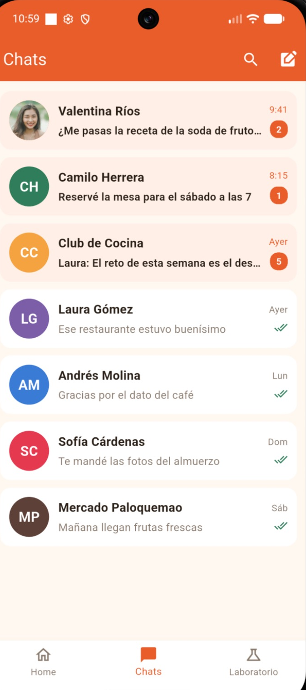
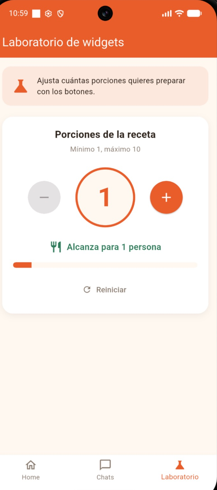

# Sazón

Aplicación móvil hecha con Flutter y Dart para el taller práctico de desarrollo móvil.

Sazón es una red social de comida donde las personas comparten recetas, bebidas y restaurantes. La app tiene tres secciones que se cambian con la barra de navegación inferior:

- **Home:** banner del reto de la semana, carrusel horizontal de categorías y publicaciones con botón de «Me gusta».
- **Chats:** lista de conversaciones con avatar, último mensaje, hora y mensajes sin leer.
- **Laboratorio de widgets:** selector de porciones que suma y resta con botones y se actualiza con `setState()`.

## Estructura

```
lib/
├── main.dart
├── theme/
│   └── app_colors.dart
├── screens/
│   ├── home_screen.dart
│   ├── chats_screen.dart
│   └── laboratory_screen.dart
└── widgets/
    ├── post_card.dart
    ├── promotional_banner.dart
    ├── image_carousel.dart
    ├── chat_tile.dart
    └── numeric_counter.dart
assets/
└── images/
```

## Cómo ejecutarlo

1. Tener instalado Flutter (`flutter doctor` para revisar).
2. Clonar el repositorio:
   ```
   git clone <url-del-repositorio>
   cd sazon_app
   ```
3. Instalar dependencias:
   ```
   flutter pub get
   ```
4. Abrir un emulador o conectar un celular y ejecutar:
   ```
   flutter run
   ```

## Capturas

| Home | Chats | Laboratorio |
|------|-------|-------------|
|  |  |  |
